# Vouch

**A clearer path from creator content to a human decision.**

Brands and creators need to agree on what a campaign asks for, what evidence supports its claims, and which exact version is ready to use. Vouch brings that work into one campaign: discover relevant creators, review submitted content, request revisions, and keep decisions attached to the evidence behind them.

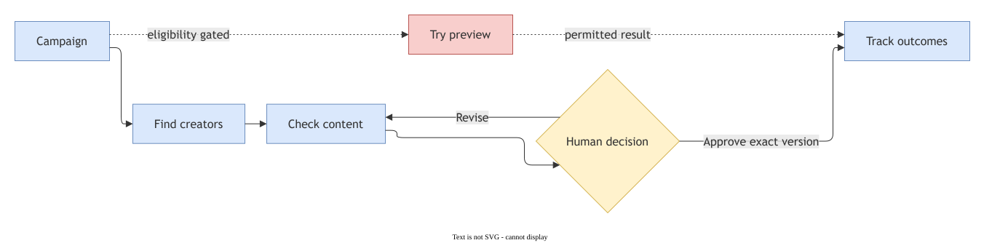

## Contents

[Product and workflow](#what-vouch-does) · [Architecture](#architecture) · [Security and identity](#identity-and-trust-boundaries) · [Review pipeline](#inside-the-check-pipeline) · [Data model](#data-and-api) · [Local setup](#run-locally) · [Testing](#verify-changes) · [Deployment](#deployment-and-demo)

## What Vouch does

| Area | Current experience |
| --- | --- |
| **Find** | Search a curated creator catalogue using available, authorized portfolio evidence. |
| **Check** | Submit an authorized draft, run a fixture analysis, inspect evidence and findings, and make an explicit human decision. |
| **Try** | Show eligibility and explain why product preview is unavailable in a restricted market. No image is generated for India. |
| **Track** | Explore a test-only outcome ledger. Test clicks and orders are not presented as actual revenue. |

Campaigns also support reusable briefs, claim evidence, requirements, readiness summaries, creator feedback and revisions, version comparison, and approval reports. An approval belongs to a particular asset, caption, analysis and rule version; a revision does not inherit it.

**Current limits:** campaign Check uses fixture providers, not live media analysis. A successful synthetic Meta API probe demonstrates connectivity, not model quality or production readiness. Try remains gated, Track contains test activity, and public deployment and Google onboarding still require end-to-end verification. The application supports review decisions; it does not certify legal compliance or publish content automatically.

## How the workflow fits together

1. A brand creates a workspace and campaign, then records the product, campaign brief, requirements and supporting claim evidence.
2. An authorized creator submits a draft and acknowledges processing. Media and derivatives are subject to retention and withdrawal rules.
3. A Check job produces evidence and findings. Requirements show **observed**, **missing**, or **unknown**; missing evidence is never silently treated as a pass.
4. A reviewer examines the findings and requests changes or makes a decision. A creator can receive selected feedback and submit a revision.
5. The reviewer compares versions and approves the exact version intended for use. A readiness brief and approval report help explain what remains and what was decided.
6. Track keeps test outcomes distinct from real orders; real integrations require their own verification.

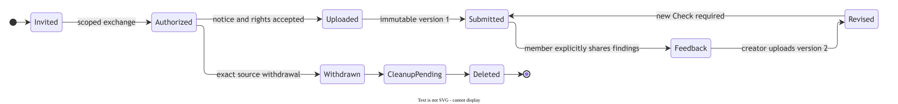

A creator invitation is a narrow capability for one creator and campaign, not a workspace login. A member creates the link; Vouch does not send outreach automatically. The guest flow can accept an initial submission and later revision, show explicitly shared feedback, and withdraw authorization. The next review is always attached to the new version.

## Architecture

The Next.js web application talks to a FastAPI service. The API authenticates users through Supabase, scopes tenant data in PostgreSQL, and stores authorized media in private Supabase Storage. A separate Check worker handles analysis jobs, while a separate retention process reconciles expiry and deletion. Model access stays server-side; human approval remains separate from machine findings.

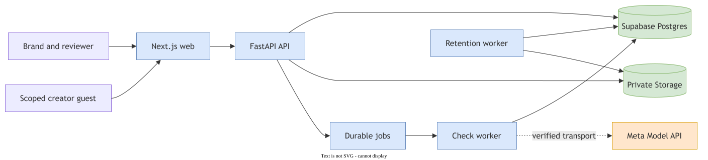

| Component | Responsibility |
| --- | --- |
| `apps/web` | Next.js interface, creator portal, authentication callback and campaign views |
| `services/backend` | API, domain rules, authorization, review workflows and worker entry points |
| `services/media-sandbox` | Optional bounded media decoding container |
| `supabase` | Database migrations and policies |
| `docs/diagrams` | Editable Draw.io SVG exports |
| `demo` | Walkthrough assets, once recorded |

Private media, scoped records, version-bound decisions and durable cleanup are part of the design. Credentials must remain in environment variables or ignored local files, never in the frontend bundle or Git history.

### Identity and trust boundaries

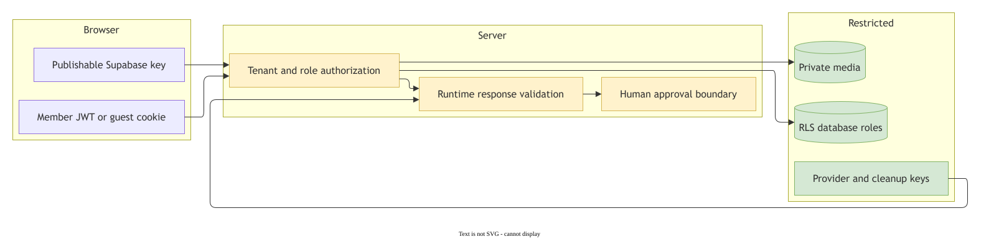

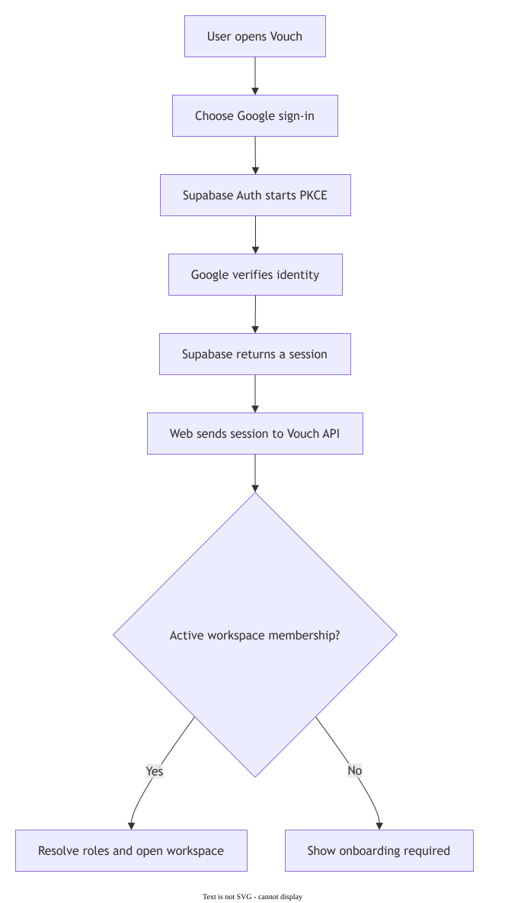

In authenticated mode, the API verifies the Supabase session and resolves the corresponding workspace membership and roles. The API, Check worker, guest access and retention process use separately restricted database identities. Organization scope follows the transaction into the database; a creator guest capability is limited to its intended submission and actions. Google sign-in requires an allowed callback and an explicit mapping from the confirmed Auth subject to a workspace membership. Provider configuration alone does not create that membership.

The fixture identity selector is a development convenience. It is not authentication and must not be exposed as access to real tenant data. The local demo and hosted authenticated mode are separate execution modes.

### Inside the Check pipeline

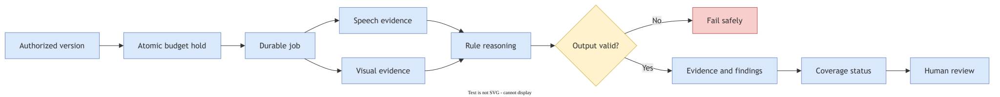

An upload is associated with a campaign and creator. The uploader attests rights and acknowledges a versioned processing notice. Finalization validates the upload and produces an immutable version and caption snapshot. Starting Check creates an asynchronous job with a budget reservation; the worker claims it with a lease and fencing token, calls the configured provider adapters, validates their output and records evidence, findings and stage provenance. The browser reads job status and results from the API.

Current Check adapters produce deterministic fixtures. They demonstrate the orchestration, retry and review behavior; they do not extract observations from the uploaded video. Optional local media decoding is a separate validation mode and does not turn fixture provider results into live analysis. Missing coverage is shown as unknown or incomplete, not as a clean result.

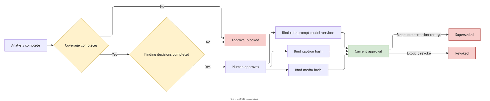

The interface separates the analysis lifecycle, machine assessment and human review. A reviewer resolves findings and records a decision. Approval requires the applicable completion and review guards, and binds to the specific manifest and version; a changed asset, caption or finding cannot silently inherit an earlier decision. The approval report records the relevant review context and limitations rather than claiming legal certification.

### Data and API

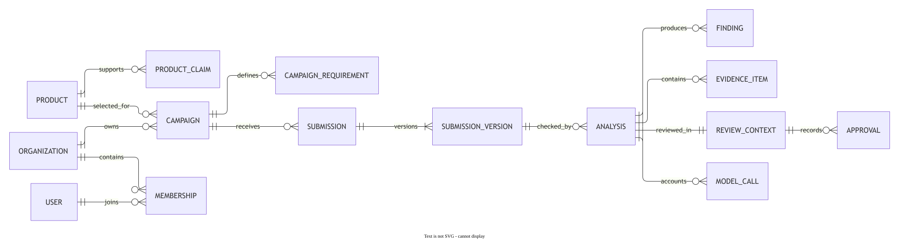

The relational model connects organizations and members to products, creators, campaigns, submissions and immutable submission versions. Checks connect those versions to evidence, findings, decisions and jobs; separate records track processing authorization, audit history and cleanup. Curated creator evidence carries its source and permission context. The Track ledger records test clicks, orders and refunds with creator and campaign attribution, stable external event identifiers and currency amounts.

The HTTP surface is defined in `services/backend/src/vouch_backend/api.py`; validation models are in `schemas.py`, domain operations in `service.py` and guest operations in `guest_service.py`. Representative routes include:

| Operation | Endpoint |
| --- | --- |
| List workspaces and campaigns | `GET /api/v1/me/workspaces`, `GET /api/v1/campaigns` |
| Create and finalize an upload | `POST /api/v1/uploads`, `PUT /api/v1/uploads/{id}/content`, `POST /api/v1/uploads/{id}/finalize` |
| Start and inspect a Check | `POST /api/v1/submission-versions/{id}/checks`, `GET /api/v1/jobs/{id}`, `GET /api/v1/checks/{id}` |
| Record review decisions | `POST /api/v1/findings/{id}/decisions`, `POST /api/v1/checks/{id}/review-decisions` |
| Review a campaign brief or test outcomes | `GET /api/v1/campaigns/{id}/brief`, `GET /api/v1/campaigns/{id}/track` |

The generated OpenAPI document and frontend wire types help keep the two sides aligned. Runtime response validation remains necessary; types alone do not validate network responses.

### Model roles and current access

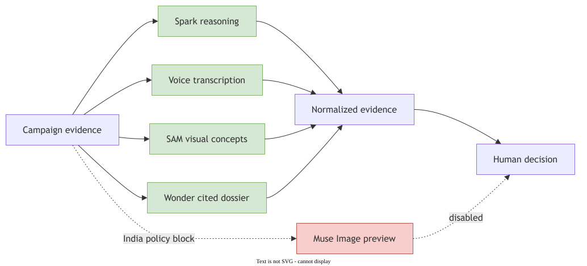

Spark is intended for structured reasoning, Voice Transcribe for speech evidence, and SAM for visual or product-concept evidence. Wonder is intended for a bounded evidence-linked dossier; Muse Image is a conditional preview capability. The product Check path currently uses fixtures for its analysis stages. Catalog access and one synthetic Spark transport call were checked separately; they do not prove live campaign quality, privacy readiness or access to every model. Muse Image is restricted for India, so Try does not collect a photo or generate an image there.

### Retention and deletion

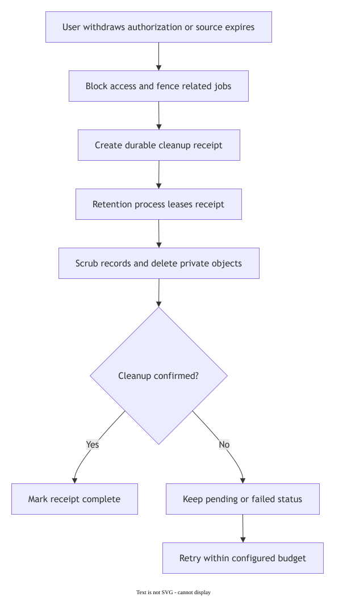

Source access has an anchored expiry. Withdrawal and deletion fence related work, invalidate access and schedule cleanup of source media and declared derivatives. A dedicated retention process discovers due work and reconciles exact storage keys using durable receipts, leases and bounded retry. A pending or failed storage cleanup is not displayed as completed erasure. Fixture providers do not create remote Meta artifacts, and the app does not promise deletion of unverified provider copies.

## Explore the diagrams

The SVG files embed their Draw.io source and can be opened in Draw.io for editing.

| Product and architecture | Workflow and operations |
| --- | --- |
| [Product loop](docs/diagrams/01-product-loop.drawio.svg) | [Authentication and onboarding](docs/diagrams/04-auth-onboarding.drawio.svg) |
| [System architecture](docs/diagrams/02-system-architecture.drawio.svg) | [Creator revision](docs/diagrams/05-creator-revision.drawio.svg) |
| [Trust boundaries](docs/diagrams/03-trust-boundaries.drawio.svg) | [Check pipeline](docs/diagrams/06-check-pipeline.drawio.svg) |
| [Data model](docs/diagrams/08-data-model.drawio.svg) | [Approval binding](docs/diagrams/07-approval-binding.drawio.svg) |
| [Model roles](docs/diagrams/09-model-roles.drawio.svg) | [Retention and deletion](docs/diagrams/10-retention-deletion.drawio.svg) |
| [Deployment topology](docs/diagrams/11-deployment-topology.drawio.svg) | [Demo walkthrough](docs/diagrams/12-demo-walkthrough.drawio.svg) |

## Run locally

You need Node.js 24 or later, Python 3.14, and [uv](https://docs.astral.sh/uv/). The default fixture mode runs the web app, API, Check worker and retention process together using local SQLite. It does not require a paid model call.

```powershell
npm.cmd run setup
$env:NEXT_PUBLIC_API_BASE_URL = 'http://127.0.0.1:8010/api/v1'
npm.cmd run dev
```

Open <http://127.0.0.1:3000>. The API normally listens at <http://127.0.0.1:8010>. Fixture mode uses local demonstration identities, not real Google accounts. Do not use fixture identity with hosted or real customer data.

For a configured hosted Supabase development environment, `npm.cmd run dev:hosted` uses the separate ignored API, worker and retention environment files. Provisioning and onboarding require project-specific access; never commit those files or share their contents. Local Supabase is optional and is not required for the default fixture demo.

### Test access

The local authenticated setup can provision test users such as `marketer@vouch.test` and `reviewer@vouch.test`; its generated password is stored locally in ignored `.local/credentials.json`. These are local test accounts, not hosted judge credentials. No public test password or verified hosted demo account is currently available.

For the local fixture demo, select the **Acme Eyewear · Maya — marketer** identity, open **Vouch Track**, and choose a campaign with the synthetic creator on its roster. Use **Record a test event** to add clicks, an order and a partial refund. For example, an order for 249900 paise and a refund of 49900 paise show ₹2,499 gross, ₹499 refunded and ₹2,000 net in the **test** panel. These are synthetic events, not connected commerce data; the live panel remains separate.

## Verify changes

```powershell
npm.cmd run check
npm.cmd --prefix apps/web exec -- playwright install chromium
npm.cmd run test:e2e
```

The default check covers API contract drift, lint, type checks, unit tests and the frontend build. Browser tests and hosted-provider behavior are separate checks. If API contracts change, run `npm.cmd run openapi` and commit the generated schema and types together.

## Deployment and demo

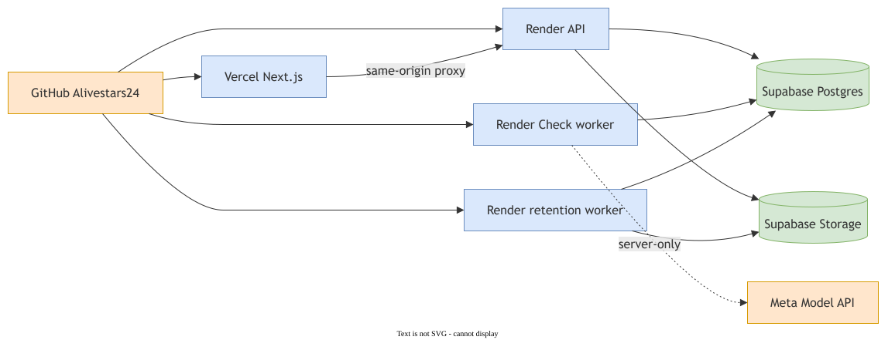

The intended deployment is Vercel for the frontend, Render for the API, and hosted Supabase for authentication, PostgreSQL and private Storage. Deployments need the correct public frontend origin, OAuth callback allowlist, restricted per-process credentials and a reliable strategy for Check and retention work. Render's free web services can sleep and restart, so a free demonstration should not be represented as an always-on production service.

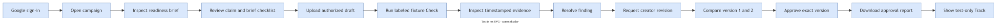

The [demo folder](demo/) is reserved for the recorded walkthrough. A video link will be added when a real recording is available. The walkthrough should show the campaign journey, review and revision, architecture, and the boundaries of fixture and live functionality.

## Technology

Next.js, React and TypeScript power the interface. FastAPI, Python and SQLAlchemy implement the API and workers. Supabase provides PostgreSQL, authentication and private storage. Draw.io diagrams document the system and its workflows.
